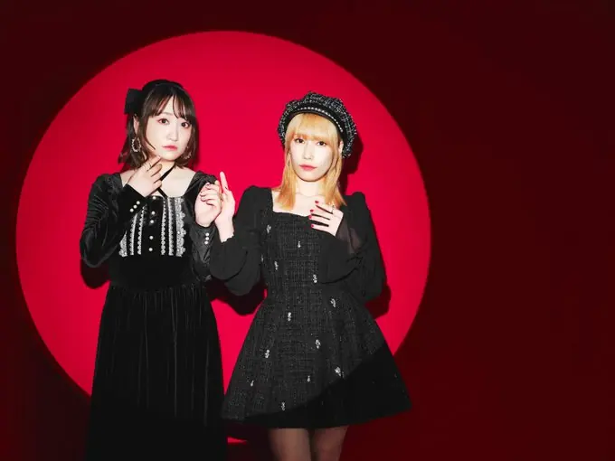
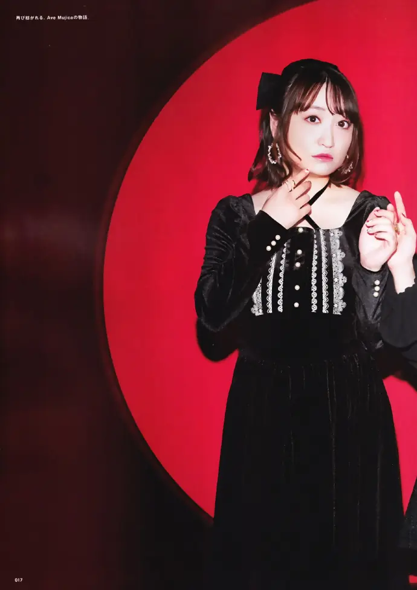
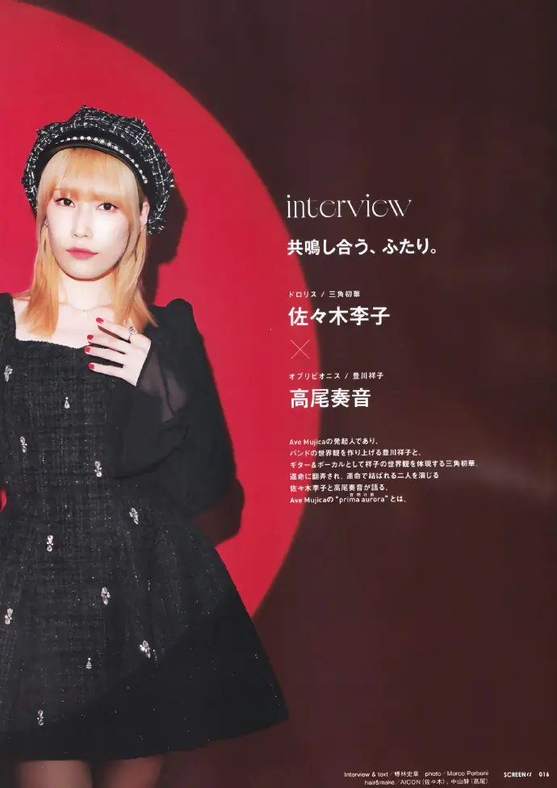
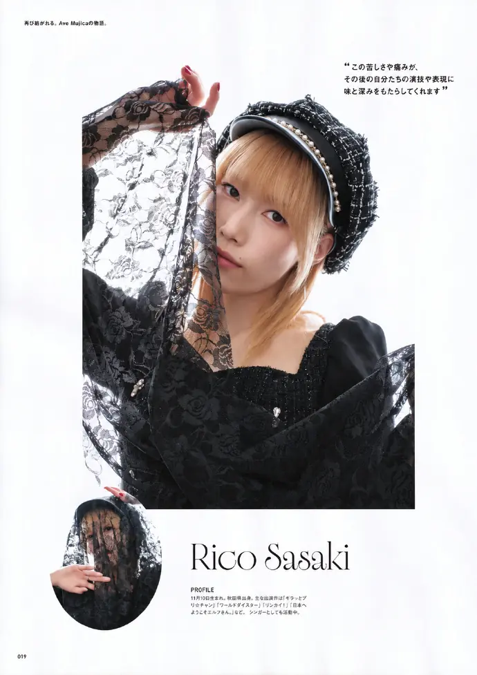
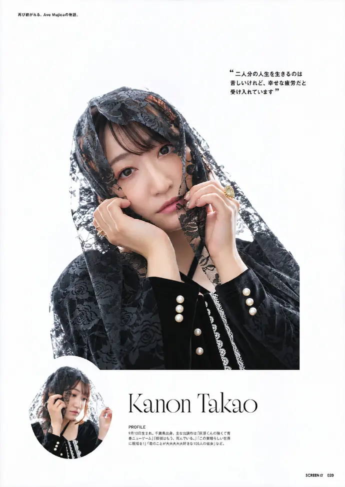
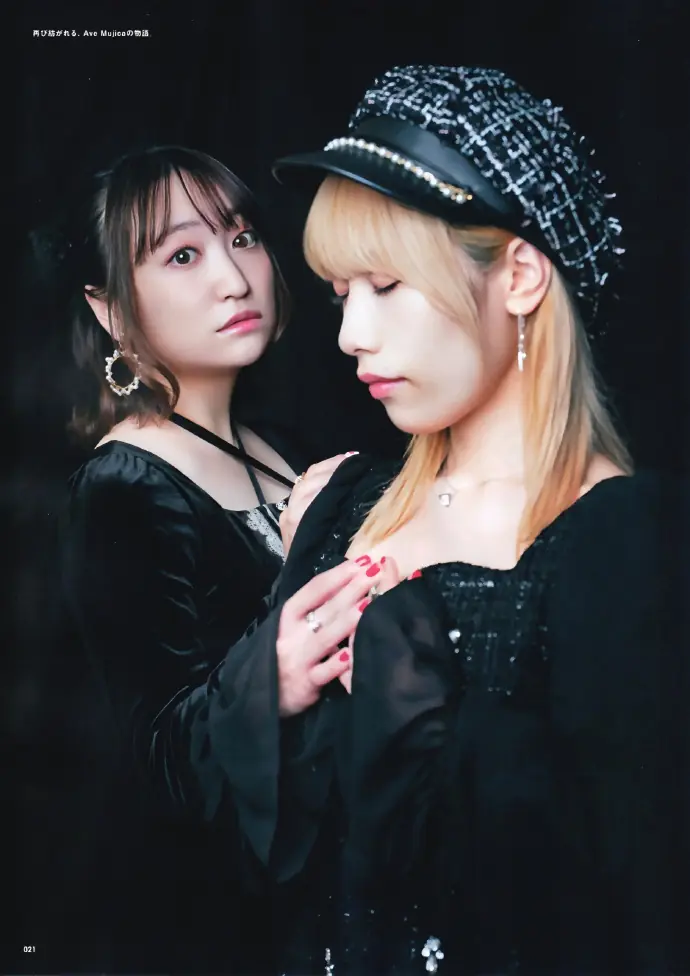
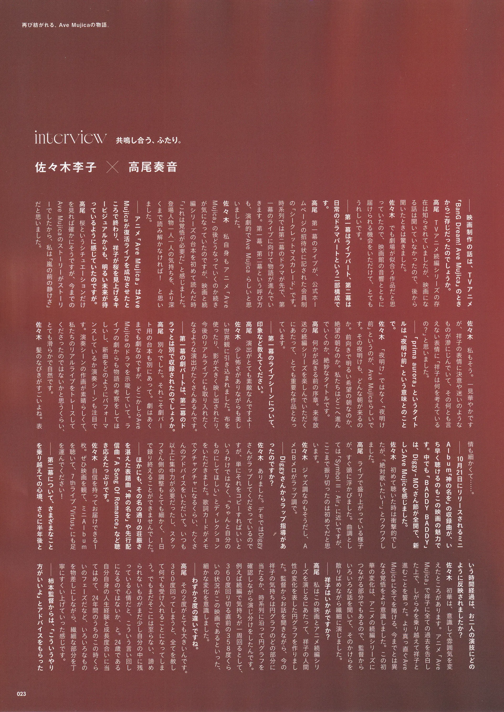
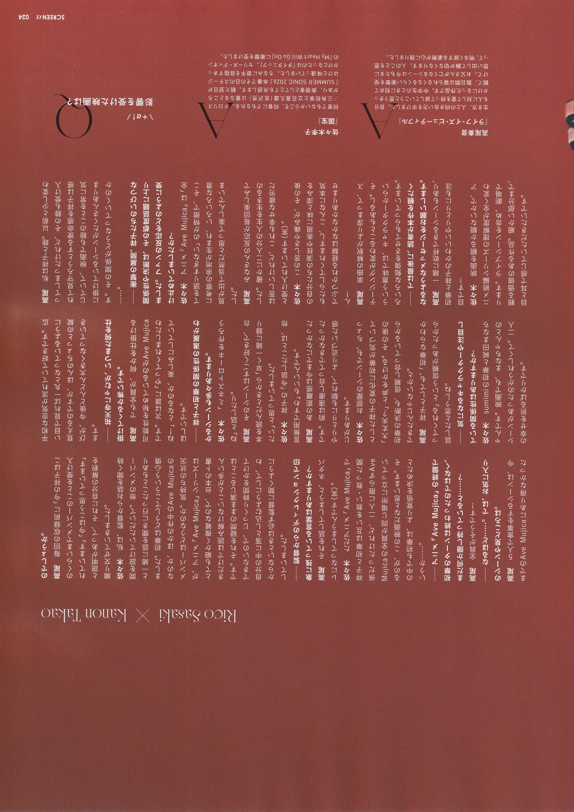

# 再度编织，Ave Mujica的故事。

**访谈时间**：2026/10/16  
**对谈人**：佐佐木李子 x 高尾奏音
**出处**：SCREENα vol.10 [扫图原图来源](https://weibo.com/5470219265/RmZHYgXUU)

[br]

（中文）

[original]

interview　共鳴し合う、ふたり。
佐々木李子 × 高尾奏音
Rico Sasaki × Kanon Takao

[/original]

[br]

（中文）

[original]

――映画制作の話は、TVアニメ「BanG Dream! Ave Mujica」のときからご存じだったのでしょうか。
高尾　TVアニメ続編シリーズの存在は知らされていましたが、映画になる話は聞いていなかったので、後から聞いたときは驚きました。
佐々木　でも劇場が似合う作品だと思っていたので、映画館の音響とともに届けられる機会をいただけて、とてもうれしいです。

――第一幕はライブパート、第二幕は日常のドラマパートという二部構成です。
高尾　第一幕のライブが、公式ホームページの招待状に記された会員制の「シークレットマスカレード」です。時系列では第二幕のドラマが先で、第一幕のライブに向けて物語が進んでいきます。第一幕、第二幕という呼び方も、演劇的でAve Mujicaらしいと思いました。
佐々木　私自身もアニメ「Ave Mujica」の後どうなっていくのか続きが気になっていたのですが、映画と続編シリーズの台本を初めて読んだ時「これは覚悟が必要だ」と感じました。登場人物一人一人の気持ちを、より深くまで読み解かなければ！　と思いました。

――アニメ「Ave Mujica」はAve Mujicaが復活ライブを成功させたところで終わり、祥子が桜を見上げるキービジュアルからも、明るい未来が待っているように感じていたのですが。
高尾　桜というシチュエーションだけを見れば確かにそうですが、今までのAve Mujicaのストーリーがストーリーでしたから、私は「嵐の前の静けさ」だと思いました。
佐々木　私もそう。一見華やかですが、祥子の表情に決意や迷いのようなものが滲んでいて、その何とも言えない表情に「祥子は何を考えているの？」と思いました。

――「prima aurora」というタイトルは、「夜明け前」という意味とのことです。
佐々木　「夜明け」ではなく「夜明け前」というのが、Ave Mujicaらしいです。その夜明けも、どんな朝が来るのか。前向きで明るい希望の朝なのか、絶望の朝なのか。私たちはどこへ進んでいくのか、絶妙なタイトルです。
高尾　何かが起きる前の序章。来年放送の続編シリーズを楽しんでいただくにあたって、とても重要な作品となっています。

――第一幕のライブシーンについて、印象など教えてください。
高尾　演出がとても素敵なんですよ！
佐々木　少し怖さがありながらも美しい世界観に引き込まれました。布を使ったり、影が大きく映し出されたり、今後のリアルライブにも取り入れたくなるような演出がたくさんあるんです。

――第一幕の劇パートは、第二幕のドラマとは別で収録されたのでしょうか。
高尾　別々でした。それこそ劇パート用の台本も別にあって。劇はあくまでも劇なので、どこかしらAve Mujicaのドラマを示唆していて。ライブの劇からも物語の考察をしてほしいし、新曲をどのようにパフォーマンスしているか演奏シーンも注目です。演奏シーンの作画が素晴らしくて、私たちのリアルライブをトレースしてくださったのではないかと思うくらい、とても滑らかで自然です。
佐々木　髪のなびきがすごいよね。表情も細かくて……。

――10月21日にリリースされるミニAlbum「神の名を」の収録曲が、いち早く聴けるのもこの映画の魅力です。中でも「BADDY BADDY」は、Diggy-MO'さん節が全開で、新しいAve Mujicaを感じました。
佐々木　初めて聴いた時は衝撃的でしたが、「絶対歌いたい！」とワクワクしました。
高尾　ライブで盛り上がっている様子が、すぐ頭に浮かびました。曲調としては「Symbol Ⅱ：Air」に近いですが、ここまで振り切ったのは初めてだと思います。
佐々木　ジャズ調なのもそうだし、AメロBメロがラップ調で。

――Diggyさんからラップ指導があったのですか？
佐々木　ありました。デモではDiggyさんがラップしてくださっているのですが、単にそれをコピーすればいいというわけではなく、「ちゃんと自分のものにしてほしい」とディレクションをいただきました。歌詞カードがメモでグチャグチャになるくらい、たくさんのアドバイスをいただいて。いつも以上に集中力が必要だったし、スタッフさん側の調整もとても細かく、1日で録り終えることができませんでした。

――ほかにも、その名の通りの荘厳さを湛えた表題曲「神の名を」や先行配信曲「A Song of Romance」など聴き応えたっぷりです。
佐々木　自信を持ってお届けできる1枚。ぜひ映画を観て、ミニAlbumを聴いて、7thライブ「Virtus」にも足を運んでください！

――第二幕について、さまざまなことを乗り越えての心境、さらに半年後という時間経過は、お二人の演技にどのように反映されましたか？
佐々木　初華は、意識して雰囲気を変えたところがあります。アニメ「Ave Mujica」で祥子に全ての過去を告白した上で、しがらみを乗り越えて祥子と進むことを誓った。より真っ直ぐAve Mujicaに全てを賭ける、今までとは異なる覚悟をより意識しました。この初華の変化は、アニメの続編シリーズにつながる部分でもあるので、監督からいろいろな話を聞いて、そのかけらを散りばめながら繊細に演じました。

――祥子はいかがですか？
高尾　私はこの映画とアニメ続編シリーズを演じるにあたって、祥子の人間性の変化を表した円グラフを作りました。監督からお話を聞きながら、今の祥子の気持ちは円グラフのどの部分に当たるか、時系列に沿って円グラフを確認しながら演じ分けをしたんです。例えば続編で気持ちが一周回るとして、360度回り切る直前の358度くらいの状況がこの映画であるといった、細かな変化を意識しました。

――わずか2度の違いですね。
高尾　その2度がとても大きいんです。360度回ってしまうと、全てを赦して何でも受け入れることになってしまう。でもまだそこには至らない、諦められないものがまだ少し自分の中に残っている心情だと、こういう言い回しになるのではないか、と。24歳である自分自身の人生経験と成長度合いに当てはめて、24年間のうちのこの時くらいのフェーズだなと、いろいろなものを物差しにしながら、繊細な部分を丁寧にすくい上げていった感じです。

――柿本監督からは、「こういうやり方がいいよ」とアドバイスをもらったのでしょうか。
高尾　毎回の収録前に「今の祥子はこのくらいまでメンバーのことを受け入れています」「今はこう思っています」と説明があって、それに自分の解釈を織り交ぜていきました。
佐々木　私は、監督からお話を聞く時間を設けていただいて。他のメンバーと一緒に話を聞きに行ったこともありました。初華はどうしてこういう心情なのか、ほかの作中のAve Mujicaのメンバーはどうなのか。気持ちの状況が、アニメ「Ave Mujica」シリーズはとても細かく複雑なので、台本のト書きだけでは読み解けないことが多いんです。それを疑問のまま演じることはできないので、じっくり時間をかけて自分の中に落とし込むようにして、わからないときは必ず監督に聞くようにしていました。

――監督からのディレクションで印象に残っている言葉はありますか？
高尾　それを話してしまうと、ネタバレになってしまうんです（笑）。
佐々木　ただアニメ「Ave Mujica」で祥子と初華は互いを救い・救った関係だったけれど、二人に限らずAve Mujicaの全員が同じ場所に立っているのが、この映画だなと思います。その中でも初華は、より覚悟を決めたというか……。

――アニメ「Ave Mujica」の終盤で初華のターンは終わったのではなく、まだ何か隠し持っていると……？
高尾　全員がそうです！

――なるほど……。では、お気に入りのシーンや見どころは。
高尾　5人で食事をするシーンは、今までのAve Mujicaにあり得なかった平和な空気が流れていて好きです。広い目で見れば一丸となっているように見えるのですが、ほんのちょっとの綻びが、今後どんどん大きくなっていきます。

――祐天寺にゃむが、いつまた何を仕掛けてくるか怖いです。
高尾　でも全員が、何かを仕掛ける可能性を秘めているのがAve Mujicaです。次は誰に「やってくれましたわね！」となるのか、楽しみにしていてほしいです。

――祥子と初華の関係性の進展がわかるシーンも多々あります。
佐々木　「ミネストローネを作ろうね」と話したり。
高尾　そのシーンはすごく好きで、台本を読んだときから「早く一緒に録りたい」と思っていました。
佐々木　祥子の「今話したことは、他言無用ですわ」もいいんです。
高尾　あの距離感は今までになかったです。前は遠慮し合ってできなかったやりとりにも馴れて、より近づいた感じがあります。
佐々木　お部屋のシーンでも、ちょっとした祥子の変化に初華が気づいて「大丈夫？」と声をかける。その後の初華の決断も、信頼し合っているからできたんじゃないかと。
高尾　祥子としても、「初華ならわかってくれる」という信頼があったから話したと思うしね。

――気になるキャラクターや注目している関係性はありますか？
佐々木　sumimiの初華と純田まなちゃんです。映画でも、まなちゃんとのシーンがあったのがうれしくて。二人の幸せを祈るばかりです。
高尾　私は祥子と睦。以前と少し変わってしまったけれど、その睦も受け入れて見守ろうとする使命感を祥子は感じていて、映画でも睦のことを常に気に掛けているシーンがたくさんあります。その関係がどうなっていくのか……。

――衝撃の展開、祥子たちのいびつな関係性や決断は、その都度話題に上りました。ファンの反応をどのように受け止めていましたか？
佐々木　アニメ「Ave Mujica」は「全てを語りすぎない」のが特徴で、そこに考察の余地が生まれ、いろいろな意見が出て当然だと思って楽しんでいました。
高尾　みなさんの反応が毎回楽しみでした。確かに二人分の人生を生きるのは苦しいけれど、これも幸せな疲労だと受け入れています（笑）。
佐々木　この苦しさや痛みが、その後の自分たちの演技や表現に味と深みをもたらしてくれますし、こんなに本気でぶつかれる経験はなかなかありません！
高尾　楽曲の解釈がより深まって、ステージングが変わることもあるし。そういう意味では、キャラクターからいろいろな勉強をさせてもらっています。

――では最後に、読者が本作を観たくなるようなメッセージをお願いします。
高尾　一緒に乾杯できるシーンもあり、初華と祥子のかわいいやりとりにも注目です！
佐々木　映画を観るか観ないかで、アニメ続編シリーズの理解度が全く変わります。ライブシーンを含め、劇場で観る価値のある作品。細かい部分まで目と耳で感じていただきたいです。

[/original]

[br]

（中文）

[original]

+α!　Q　影響を受けた映画は？

A　佐々木李子『国宝』
何者でもないからこそ、何者にでもなれる。ドロリス／三角初華と立花喜久雄（吉沢亮）は重なるところがあり、表現者としてとても共感します。観た翌日が「SUMMER SONIC 2026」本番でその日のステージはひと味違っていました。ちなみに歌手を目指すきっかけとなったのは「タイタニック」。セリーヌ・ディオンの「My Heart Will Go On」に衝撃を受けました。

A　高尾奏音『ライフ・イズ・ビューティフル』
生き方、人との向き合い方を学びました。自分も人に対して愛を持って接していこうと思うきっかけになった作品です。中学生のときに初めて観て、数日間は寝られなくなるくらい衝撃を受けて。お父さんが亡くなるシーンは今もたまに思い出して胸が切なくなります。人のことを思って、明るく接する姿勢が心に残りました。

[/original]

[br]

杂志宣传图：

[br]

[br]

杂志扫图（弄李部分）：

[br]

[br]

[br]

[br]

[br]

[br]

[br]

[br]

[br]

[br]

